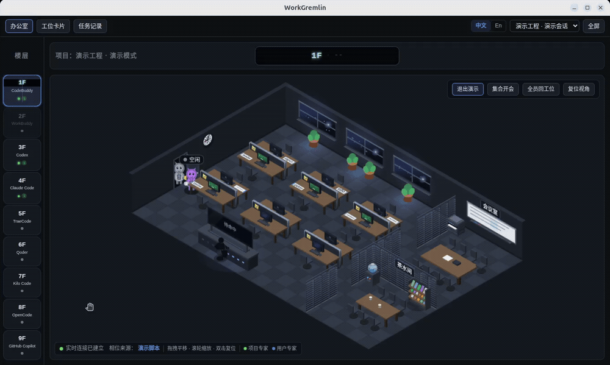

# WorkGremlin

Turn the AI coding agents running on your machine into a **visible office**: who is online, what they are busy with, which floor is working — all at a glance. You can also invite agents from several floors into a **council** to discuss one topic to agreement, or to analyze whether an approach holds up.

## Demo



## Quick start

```bash
# Requirements: Node >= 18 (Vite needs it in dev mode); on Linux also python3 + make + g++ (better-sqlite3 is compiled during npm install).
# server/client run on Electron's bundled Node, so you do not install Node separately.
node -v && npm -v && python3 --version && which make g++

# Install dependencies (postinstall runs electron-rebuild to rebuild better-sqlite3)
npm install

# Start (Electron's Node runs the server + opens the desktop window; after the app exits the server stays resident in the background)
npm run launch:electron

# Dev mode (Vite HMR + Electron window): npm run dev
# Build the renderer then start (prod): npm run build:electron
# Run only the local server, no window: npm run server
# Just check the native module works (create table → write → read back): npm run db:check
```

**Demo mode**: once it is up, click "Demo mode" on the bottom-right action bar (left of "Gather for a meeting") — the UI switches to an isolated **demo project**, the main console automatically plays a full round, and the members in the room become the demo team (6 experts + 2 temporary members). Click "Exit demo" again to return to the project that was open before.

## Four pages

### Office (default)

An isometric (2.5D) office that draws "which agent is doing what":

- **Floors**: pick a floor from the capsules on the left; switching plays an **elevator animation** (doors close, the car changes floors behind them, doors open on the new floor); each floor has its own furniture material/color so you can tell where you are. The dot/number on a capsule = whether that floor has active sessions and how many; products that are not installed are greyed out and not clickable. The lintel shows the current project name and floor.
- **Main agent console**: the floating screen shows its current phase — `idle / unreported / thinking / calling a tool / delegating to an expert / awaiting permission / waiting (for a subagent to report) / task done / task cancelled`. Hover the screen to pop up the action, target, skills and context; the bottom-left marks whether this phase is a **reported truth / inferred value / demo script**.
- **Gremlins (subagents at their desks)**: they walk in through the front door one by one and sit down; when summoned by the main agent (the `task` tool) they run to the **right side** of the console, take the task, reply "got it", then go back to their desk to work, and report the result at the console when done; while summoned, a **ghost** (this subagent instance) appears above their head and floats in through the front door. Idle ones go get water, print, or chat with someone; two or more blocked ones gather for a meeting on their own.
- **Interaction**: drag to pan · scroll to zoom · double-click to reset; click a desk for the task card; hover a gremlin for its current task; hover the console screen for phase details; `F` fullscreen / `Esc` exit fullscreen.
- **Top-bar session dropdown**: pick a session and the main console shows **that session's own** phase (with several sessions open, each shows its own — no cross-talk); with none picked it follows the current floor.
- Bottom-right action bar: `Demo mode` / `Gather for a meeting` / `Everyone back to their desks` / `Reset view`.

### Desk cards

One card per member on the current floor (the main agent is always the first):

- **Role**: main agent / project subagent / user subagent;
- **State**: only two levels — busy / idle (the status dot and the text share the same color; you never get a "green dot + idle");
- **Current task**: the one in progress; when idle it honestly says "idle" and does not leave the previous task on the card;
- **Description**: the "what it does" written in the subagent definition (static information, not state);
- **Time**: in progress shows "started MM-DD HH:mm", idle shows "last active MM-DD HH:mm";
- members that do not report are marked "passively observed" and their state is greyed out as inferred.

Only resident gremlins are listed; ghosts summoned temporarily do not take a card slot (avoiding the "summon once, one more in the list" confusion).

### Task records

The filters at the top apply to all three views at once:

- **Project / floor** (fetched from the server), **state / time / keyword** (filtered further on the current result);
- **Time** has eight presets: all time / today / yesterday / last 7 days / last 30 days / this month / last month / custom (custom reveals two date boxes). The basis is the task's **start time**, by calendar day.

1. **List view** — one row per task; open the details on the right: state, client, model, project, changed files, **tokens** (uncached input / cache read / cache write / output written separately; floors that cannot report it show "—" not 0), tool-usage counts, output result, and the subagent details it summoned. You can delete a single row, "delete the filtered results" for the current filter, and set the automatic retention days (default keeps the last 90 days; older ones are cleaned up by the server).
2. **Summary report** — the first tab is **data overview**: a per-row list `time / task / client / model / project / tokens / duration / state` (the task title takes only the first 10 characters plus an ellipsis; hover to see the full text; click any row to jump back to the list with that task selected). There are also **by project / by model / by floor** aggregate tables: task count, success count, cancelled count, changed-file count, total tokens, total duration, average duration; click a row to drill down to the list. The whole table can be exported to CSV.
3. **Graphical board (daily)** — one **floor × time** Gantt chart per day: the horizontal axis is 00:00–24:00 (one vertical line per hour), the vertical axis is floors (e.g. "3F Codex"), and the blocks in a row are that floor's tasks, colored by the task's state. When several run in parallel at the same time, the overlapping stretch is **darkened** (one row per floor, no stacking downward); when viewing today there is a "now" dashed line; click a block to jump to that task in the list. **Which days you can page back/forward to is decided by the time filter above** (buttons outside the window are greyed out). Days with no tasks still draw an empty table; when the filter is "all floors", **every installed floor gets its own row** (empty ones stay blank).

### Council

The first three pages are all about **looking** (others run the agents, we read the traces they leave). The council is the only page that **uses**: pick a few floors and start a multi-round discussion on one topic.

- **How to start**: write the topic (paste the text) → tick floors → pick the **deliberation style** → optionally paste a few file paths (the server reads the text and inlines it into the prompt; over the limit it truncates and the UI states "original N bytes, only the first M inlined") → optionally set a **working directory** → set the max rounds → start. **Only floors that are installed and can be invoked headlessly are selectable**; the rest are greyed out with the reason (e.g. "no command-line executable found").
- **Two deliberation styles** (two independent switches; any combination works):
  - **Vote** (default): in round 0 the server puts the topic on the table (no stance); in rounds 1..N each person speaks first, ending with a structured `{"vote":"agree|disagree|abstain","reason":"…"}` block; anyone voting against also gives an amendment. **The server counts the votes** — if the round has no objections and enough yes votes for a majority, it is agreement, and the conclusion is **the proposal text on the table** (quoted verbatim; the server does not synthesize or rewrite it); otherwise the amendment with the most seconds goes on the table and the discussion continues; if the round limit is reached without agreement it honestly says "no agreement" and lists each side's position and the last proposal.
  - **Analysis**: no voting, no consensus. Each person ends each round with `{"stance":"support|oppose|unsure","points":[…],"risks":[…],"questions":[…]}`; after the full number of rounds you get a **grouped briefing** (support / oppose / unsure / no stance), each person's conclusion, risks and open questions **listed verbatim** — the server does not synthesize a sentence. Good for questions with no "agreed or not", like "is this bug-fix approach sound" or "could it cause a regression".
  - Both show participants **all previous rounds' utterances** in the prompt.
- **Where to talk also has two modes**: **blank** (default) is isolated — a throwaway temp directory the server creates, deleted after each council, and participants have **no tools** (talk only). **An absolute path** (your project directory) is workspace mode — participants use it as the working directory and get **read-only tools**, so they can look up code themselves (read files, search by name/content), read when unsure instead of guessing; **they cannot modify any file, run commands, or access the network**. The server **does not change a single line** in that directory and does not delete it afterwards. Use this mode when asking "could this regress".
- **Not in the office**: participants do not appear in the office or in task records; they are visible only in the council. In workspace mode this takes two extra locks (turn off WorkGremlin's own reporting; 7F/8F participant sessions carry a fixed title that the office's session list skips) — see `docs/requirements.md` §15.3 for details.

Two things it does **not** do, to avoid misunderstanding: ① it does not touch the sessions you are running (no commands, no interruptions); ② it does not make up a conclusion for you — if someone did not answer, a process crashed, or the output cannot be parsed, that vote (or stance) stays blank, the UI says "no stance" and shows the raw error; it **never treats "did not reply" as agreement, and never guesses from tone**. Tokens it cannot get show "—", not 0.

## Supported floors

One monitored product per floor (the left capsules are ordered this way); **a floor is clickable only if installed**, otherwise greyed out:

| Floor | Product | Form |
| --- | --- | --- |
| 1F | CodeBuddy | CLI (terminal) and IDE plugin, merged into one floor |
| 2F | Cline | CLI and VS Code extension (same on-disk store, merged into one floor) |
| 3F | Codex | CLI and IDE plugin (same on-disk store, merged into one floor) |
| 4F | Claude Code | CLI and IDE plugin (same on-disk store, merged into one floor) |
| 5F | TraeCode | IDE proper and plugin |
| 6F | Qoder | CLI and plugin (same on-disk store, merged into one floor) |
| 7F | Kilo Code | Terminal TUI and VS Code extension |
| 8F | OpenCode | CLI / TUI / desktop / web (same data) |
| 9F | GitHub Copilot | VS Code plugin |

Among them, **1F / 4F / 7F / 8F can also join the council** (these four are verified to be invocable headlessly and to have tools disabled); the other floors do not appear in the council candidates even if installed, and the other pages still show them.

## What it shows and does not show

- **Only truths**: state, tasks, files and duration all come from the agent's own reports or its local on-disk data; if it cannot get them it writes "unreported / —" rather than making up a number.
- **No fake progress**: the progress bar is gone — when there is no real per-round progress to advance, drawing one would only deceive.
- **Two state levels**: busy / idle (the office nameplate and the cards use the same rule); finer phases are written only on the main console screen.
- **Grey when the heartbeat stops**: a member with no heartbeat for over 60s is marked degraded (an inferred value) and greyed out with a label.

## Data and configuration

- All data lives in `~/.workgremlin/`: `workgremlin.db` (one SQLite database) + each product's state files. Change the directory with `WORKGREMLIN_HOME`, change the database file with `WORKGREMLIN_DB`.
- At startup it **automatically writes the "status reporting hook" into the config of installed products** (only adds/updates our own entry, backing up to `.bak-workgremlin` before changing). To opt out of automatic config changes: `WORKGREMLIN_NO_AUTO_HOOKS=1`.
- Open a project: decided at server startup — `WORKGREMLIN_WORKSPACE=<dir>` (or `npm run server -- --workspace <dir>`); if neither is given it uses the directory it was started from. The last opened project is remembered and restored on the next startup.
- Logs: by default outputs `info` / `warn` / `error`, and writes per-day to `~/.workgremlin/logs/workgremlin-<YYYY-MM-DD>.log`. For finer troubleshooting: `WORKGREMLIN_LOG=debug` (or `npm run server -- --log=debug`) enables per-event debug; to see only problems: `WORKGREMLIN_LOG=error`; `WORKGREMLIN_LOG_FILE=0` turns off file logging. **Keeps only 7 days by default** (`WORKGREMLIN_LOG_KEEP_DAYS` changes it): expired per-day files and expired lines in `hooks/events.log` are cleaned up at startup / when the day changes.

## Documentation

| What you want | Which file |
| --- | --- |
| What this release shipped, known issues | `docs/releases/` |
| What the product requires, acceptance criteria | `docs/requirements.md` |
| How the code actually works, where it diverges from the docs | `docs/implementation-status.md` |
| Tech choices and data structures | `docs/tech-design.md` |
| Run it / troubleshoot | `docs/runbook.md` |
